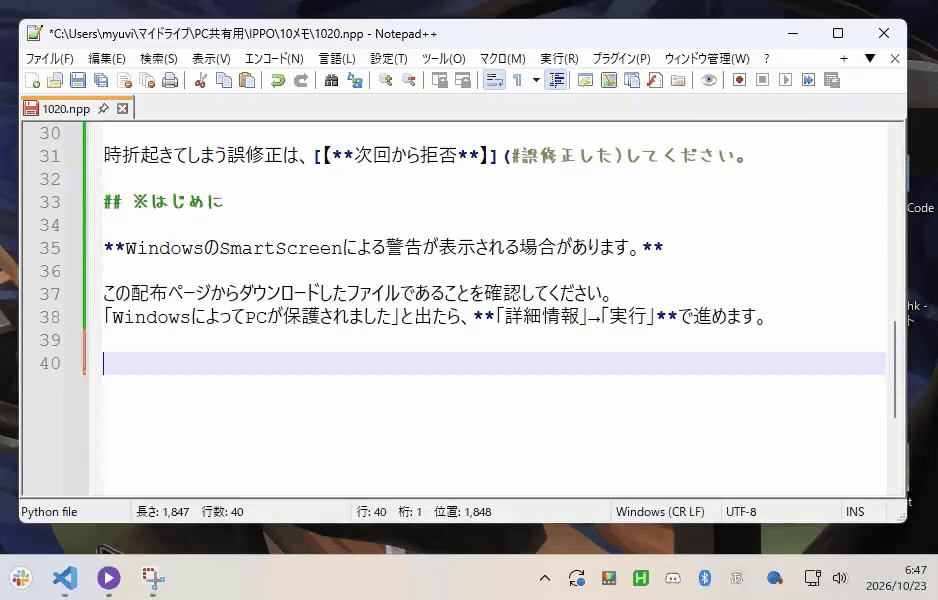

# IPPO Future

## 概要

日本語入力の打ち間違いを自動で直す、**Windows 64bit向けのアプリ**です。**β版です**。

**ユーザーさんが気付いてなさそう＆直せそう**　を判断材料にこっそり直してくれます。

時折起きてしまう誤修正は、[【**次回から拒否**】](#誤修正した)してください。

## 紹介動画

## ダウンロード

**[Windows版をダウンロード（ver3）](https://github.com/Ruseu29/IPPO-Future/releases/download/ver3/IPPOFuture-ver3-Setup.exe)**
管理者権限・Pythonのインストール不要

[旧版はこちら](https://github.com/Ruseu29/IPPO-Future/releases)

困ったら：[以前のものから更新したい](#以前のものから更新したい) ・ [状態の見方](#状態の見方) ・ [起動できない](#起動できない) ・ [修正されない、されすぎる](#修正されないされすぎる) ・ [誤修正した](#誤修正した) ・ [停止・削除](#停止削除)

## ※はじめに

**WindowsのSmartScreenによる警告が表示される場合があります。**

この配布ページからダウンロードしたファイルであることを確認してください。
「WindowsによってPCが保護されました」と出たら、**「詳細情報」→「実行」**で進めます。

## 使い方

1. ダウンロードした **インストーラのEXE** を開き、画面に従ってインストール。
2. スタートメニューの **「IPPO Future」** から起動。デスクトップへの追加もインストール時に選べます。
3. 自動修正が始まり、最小化します。終了したいときは、いつでも「設定」の **×** で閉じてください。

**サインイン時の自動起動は初期ON**です。不要ならインストール時のチェックを外してください。後からWindowsの **設定 → アプリ → スタートアップ** でもOFFにできます。

## 状態の見方

| 表示 | 意味 |
| --- | --- |
| **動作中** | 入力を監視し、条件に合えば自動修正します。 |
| **観察のみ** | 判定はしますが、文字は修正しません。 |
| **停止中（修正停止）** | 監視・修正を止めています。「開始」で再開します。 |
| **送信中断（待機中）** | 一時待機中。Enter・Space・Tabやクリックなどで入力を区切ると再開します。 |
| **拒否済み・中断** | 拒否登録した修正だけ見送り、監視は続けます。 |
| **エラー** | 安全のため停止中。画面のエラー内容を確認してください。 |

## 困ったとき

### 以前のものから更新したい

IPPOを **×で終了** し、新しい版のインストーラを実行してください。設定・修正履歴・拒否登録は引き継ぎます。

旧ZIP版から移る場合も同じ手順です。旧ショートカットは使わず、新しくできる **「IPPO Future」** から起動してください。旧版のタイプログは自動移行しないため、必要なら旧版の **「学習ログ」フォルダ** を保管してください。

### 修正されない、されすぎる

環境設定の **「修正パワー調整」** を開き、プリセットを選んでください。

- **弱**：修正を控えめにします。誤修正をしないことを意識する人向け。
- **中**：そこそこ通りやすくなります。
- **強（初期値）**：人の目で見ても判断に困る案が通りやすくなります。相性次第。

変更後は **「修正パワーを保存」** を押してください。

### 誤修正した

**`Ctrl + Alt + R`** で、直前に実行された修正を**次回から拒否**できます。文字を元に戻す操作ではありません。拒否の取り消しは **「拒否一覧・解除」** から。

### 起動できない

まずスタートメニューの **「IPPO Future」** から起動してください。見つからない場合や、ファイルが見つからないというエラーが出る場合は、インストーラをもう一度実行してください。

### 停止・削除

入力がおかしくなったら **`F8` または「停止」**。止まらなければタスクマネージャーから `IPPO Future` を終了してください。

削除するときはIPPOを **×で終了** し、Windowsの **設定 → アプリ → IPPO Future ver3 → アンインストール** を選びます。

**設定・ログは残ります。** すべて消す場合は、アンインストール後にエクスプローラーで `%LOCALAPPDATA%` を開き、その中の **「IPPO Future」フォルダ** も削除してください。

### 入力は保存される？

**「タイプログの保存」は初期ON**です。ログの活用機能が間に合っていないため、不要なら環境設定でOFFにしてください。どちらを選んでも外部にデータ送信はされません。

保存先は `%LOCALAPPDATA%\IPPO Future\学習ログ`。保存ONのときは、分析の **「タイプログを開く」** から確認できます。

### Macでは使える？

現在はWindows専用です。Mac対応も早めに進めたい一方、開発者自身がMacで常用できないため、将来的に実機での試用協力が必要です。

## フィードバック

感想・ご要望・不具合の報告は、[**フィードバックフォーム**](https://forms.gle/vu8axuC6g224MZCr8)へお願いします。
他にも誤修正や使いづらさなど、Discord等で報告していただければ確認・返信します（リンクは追記予定）。
